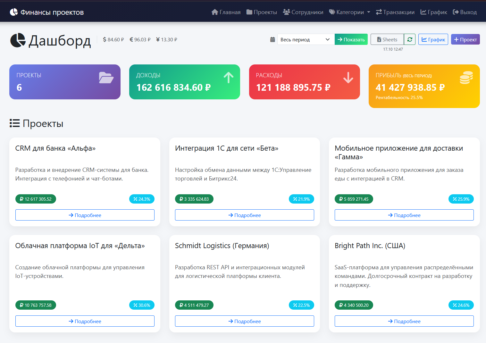
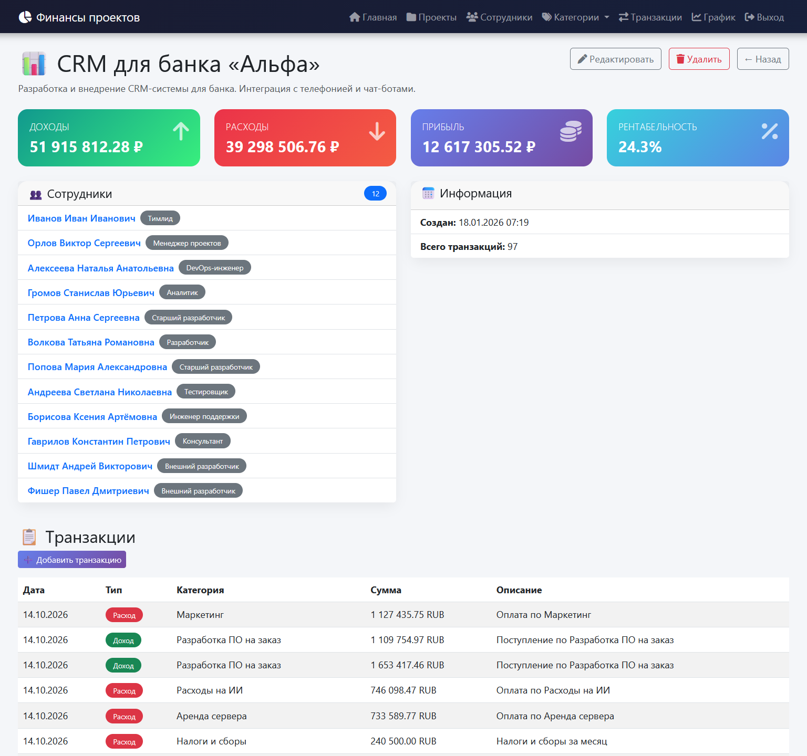
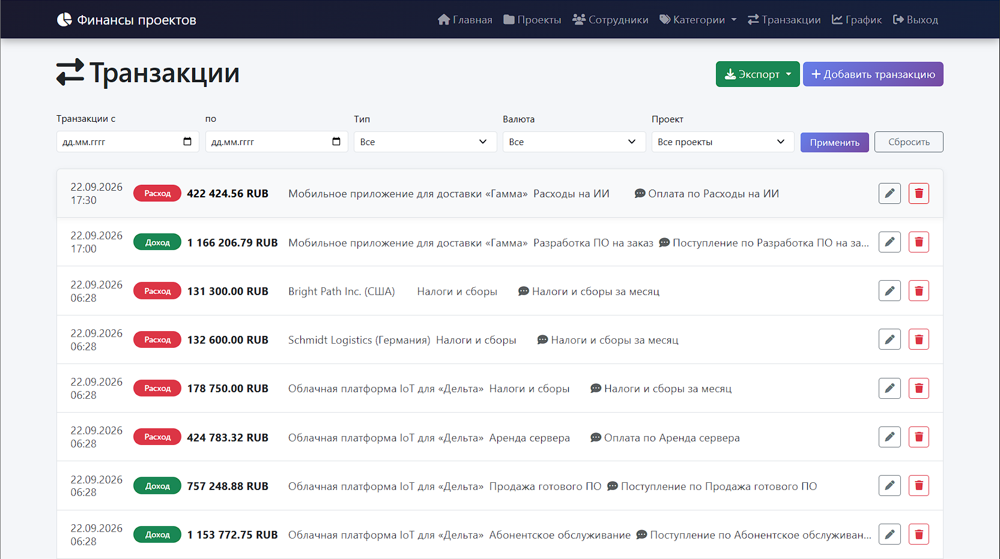
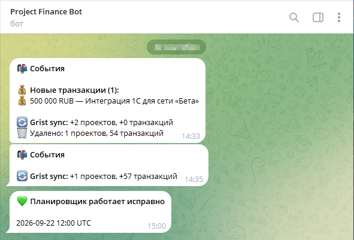
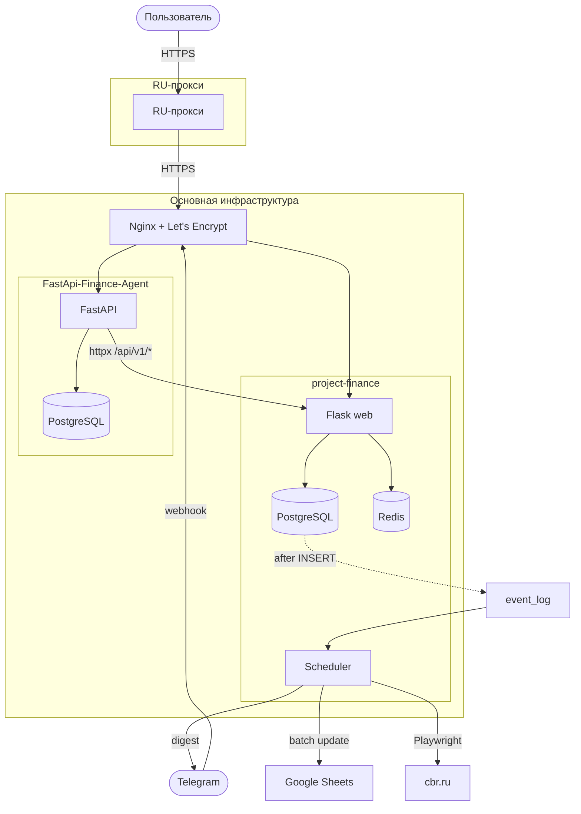

# 💰 Финансы проектов

[](https://github.com/daniil-avdeenko/project-finance/actions/workflows/ci.yml)
[](https://github.com/daniil-avdeenko/project-finance/actions/workflows/deploy.yml)
[](https://github.com/daniil-avdeenko/project-finance/releases)
[](https://www.python.org/downloads/)
[](https://github.com/astral-sh/ruff)
[](LICENSE)

Flask-приложение для учёта доходов и расходов по проектам: CRUD,
аналитика рентабельности, экспорт в CSV/Excel, синхронизация с Google Sheets,
event-driven уведомления в Telegram, планировщик фоновых задач.

**Live demo:** https://projectfin.com.ru/ — логин `admin` / `admin` (демонстрационные учётные данные)

**Связанный проект:** [FastApi-Finance-Agent](https://github.com/daniil-avdeenko/FastApi-Finance-Agent) —
Telegram AI-агент на LangGraph + GigaChat, который ходит в публичный REST API
этого приложения и отвечает на вопросы о финансах на естественном языке.

**Скриншоты:**

| Дашборд | Карточка проекта |
|---|---|
|  |  |

| Транзакции с фильтрами | Telegram-уведомления |
|---|---|
|  |  |

## Возможности

- **CRUD** проектов, сотрудников (с ролями на проектах), категорий и транзакций. Роли: `admin` / `user`.
- **Дашборд** с доходом, расходом, прибылью и рентабельностью за выбранный период.
- **Мультивалютность.** Транзакции в RUB / USD / EUR / CNY конвертируются в рубли по курсу ЦБ на дату транзакции.
- **Курсы ЦБ** парсятся с `cbr.ru` через Playwright (с обходом DDoS-Guard) и сохраняются в БД.
- **Кэш Redis** для курсов и категорий — TTL 1 час, инвалидация при обновлении, graceful degradation при недоступности Redis.
- **Экспорт** в CSV, XLSX (openpyxl) и синхронизация с Google Sheets: проекты, транзакции и последние курсы валют, с валидацией полей и retry на 429/5xx.
- **Event-driven уведомления** в Telegram через очередь событий в БД и отдельный процесс-планировщик.
- **Публичный REST API** `/api/v1/*` — используется внешним Telegram-агентом.
- **Ручная синхронизация** из UI с отображением статуса и времени последней синхронизации.
- **Адаптивная вёрстка** — десктоп 125–250% браузерного зума, мобильные 360–375px (карточная раскладка списков, аккордеон фильтра графика).
- **Security:** rate limiting на логин через Redis (fallback на memory при недоступности), HTTP security headers, CSP, sanitize секретов в логах, fail-fast на `SECRET_KEY`, валидация `next`-редиректов, `ProxyFix` для корректного определения схемы и IP за reverse proxy.

## Архитектура



**Ключевые решения:**

- **Разделение процессов.** Web и scheduler — два независимых контейнера. Scheduler запускается отдельно от Flask, чтобы фоновые задачи не дублировались при нескольких воркерах gunicorn.
- **Event-driven.** Flask не вызывает Telegram напрямую — пишет событие в `event_log`. Scheduler раз в 30 секунд собирает pending-события и отправляет digest. Отказ Telegram не блокирует UX, события не теряются.
- **Идемпотентность.** Google Sheets перезаписывается целиком при каждой синхронизации, с retry на 429/5xx. Повторный запуск обновляет, а не дублирует.
- **Развязка сервисов.** Агент общается с приложением только через публичный API `/api/v1/*`. Нет shared-credentials к БД — проекты можно менять и деплоить независимо.
- **Кэширование и N+1.** Курсы ЦБ и категории кэшируются в Redis (TTL 1 час, инвалидация при обновлении). В экспортерах и API используется `ProjectStatsService` с предзагрузкой — вместо запроса курса на каждую транзакцию.

## Стек

| Слой | Технологии |
|---|---|
| Backend | Python 3.12, Flask, SQLAlchemy 2.0, Flask-Login, WTForms |
| БД | PostgreSQL 16 (prod), SQLite (dev) |
| Кэш | Redis 7 |
| HTTP / async | httpx, APScheduler |
| Browser | Playwright (Chromium) |
| Интеграции | Google Sheets API, Telegram Bot API, ЦБ РФ |
| UI | Bootstrap 5, Chart.js, Font Awesome |
| Экспорт | CSV (stdlib), XLSX (openpyxl) |
| Тесты | pytest, pytest-asyncio, pytest-cov, respx, fakeredis |
| Качество | ruff, mypy, pre-commit, gitleaks |
| Инфраструктура | Docker, Nginx, Let's Encrypt |

## Быстрый старт

### Локально

```bash
git clone https://github.com/daniil-avdeenko/project-finance.git
cd project-finance

python -m venv .venv
source .venv/bin/activate              # Windows: .venv\Scripts\activate
pip install -r requirements-dev.txt    # prod + dev-tooling

cp .env.example .env                   # заполнить токены интеграций или оставить пустыми для минимального запуска
flask db upgrade && python seed.py     # миграции + тестовые данные

playwright install chromium
python run.py                          # http://127.0.0.1:5000
```

**Планировщик** (отдельный терминал):

```bash
python -m scheduler.runner
```

### Docker (dev)

```bash
docker compose up -d
```

Поднимаются `pf-web` (порт 5000), `pf-scheduler` (healthcheck на 8080) и `redis`. Один образ для web и scheduler, разные команды запуска.

## Публичный API

REST API `/api/v1/*` — используется Telegram-агентом
[FastApi-Finance-Agent](https://github.com/daniil-avdeenko/FastApi-Finance-Agent).
Без авторизации, rate limit 60 req/min на IP.

| Метод | Путь | Назначение |
|---|---|---|
| GET | `/api/v1/health` | Healthcheck |
| GET | `/api/v1/summary` | Сводка за период |
| GET | `/api/v1/projects` | Список проектов |
| GET | `/api/v1/projects/<id>` | Детали проекта + транзакции |
| GET | `/api/v1/transactions` | Транзакции с фильтрами и пагинацией |
| GET | `/api/v1/currencies` | Курсы валют ЦБ (USD, EUR, CNY) |

Swagger UI: `/api/v1/docs` (за `@login_required`).

## Тестирование и CI/CD

- **`pytest`** — 283 теста, покрытие 88%. Unit (формы, хелперы, сервисы, кэш, rate limit storage) + integration (роуты, API, БД).
- **Pre-commit** — ruff (линтер + форматтер), mypy, gitleaks, conventional-commit.
- **Pre-push hook** — блокирует прямой push в `main`, push с незакоммиченными изменениями и нарушение конвенции имён ветвей. Пуш тегов не блокируется.
- **GitHub Actions** — три параллельных job'а на PR: `Tests`, `Lint & Type Check` (ruff + mypy), `Secrets scan` (gitleaks).
- **Deploy Preview** — на каждый PR собирает изолированный стек на GitHub-hosted runner, гоняет smoke-тест на `/healthz`.
- **Deploy** (prod) — после merge в `main` через `workflow_run` после зелёного CI. Self-hosted runner на сервере, SSH-порт наружу не открыт — runner сам опрашивает GitHub.

## Управление зависимостями

Зависимости разделены на prod и dev, lock-файлы генерируются через `pip-tools`.

| Файл | Назначение |
|---|---|
| `requirements.in` | Прямые prod-зависимости без версий |
| `requirements-dev.in` | Prod + dev-tooling (pytest, ruff, mypy, pre-commit) |
| `requirements.txt` | Lock-файл prod (в Docker-образ) |
| `requirements-dev.txt` | Lock-файл dev (локально, в CI) |

**Docker-образ** ставит только `requirements.txt` — без pytest, ruff, mypy и их транзитивных зависимостей.

**Обновление lock-файлов.** `pip-compile` запускается в Linux-контейнере (`scripts/requirements-compile.Dockerfile`) — это гарантирует, что linux-only пакеты и маркеры платформы резолвятся корректно, независимо от ОС разработчика.

```bash
./scripts/compile-requirements.sh      # Linux / macOS / Git Bash
.\scripts\compile-requirements.ps1     # Windows PowerShell
```

## Структура

```
app/
├── models.py                  # SQLAlchemy-модели
├── events.py                  # SQLAlchemy listeners для event_log
├── forms.py, helpers.py       # WTForms, утилиты
├── routes/                    # CRUD-роуты по сущностям
├── api/v1/                    # публичный REST API
├── cache.py                   # клиент Redis (singleton, graceful degradation)
├── integrations/
│   ├── google_sheets.py       # gspread + валидация + retry + base64 credentials
│   ├── telegram.py            # Bot API, sanitize трейсбеков
│   └── cbr_scraper.py         # Playwright + обход DDoS-Guard
├── services/
│   ├── currency_service.py    # upsert курсов, конвертация, кэш
│   ├── category_service.py    # кэш категорий
│   ├── project_stats.py       # расчёт показателей без N+1
│   ├── excel_export.py        # xlsx через openpyxl
│   └── sync_service.py        # SyncLog, короткие ошибки для UI
├── templates/, static/
└── security.py                # HTTP headers + sanitize секретов

scheduler/
├── jobs.py                    # process_events, healthcheck, scrape_cbr, sync_sheets
└── runner.py                  # точка входа APScheduler + healthcheck на :8080

migrations/versions/            # Alembic
tests/                          # pytest-тесты
scripts/                        # вспомогательные скрипты
Dockerfile, docker-compose.yml, docker-compose.prod.yml
```

## Документация

- [CHANGELOG.md](CHANGELOG.md) — история версий.
- [SECURITY.md](SECURITY.md) — политика безопасности и ответственного раскрытия уязвимостей.

## Что планируется улучшить

- **Batch API для Google Sheets.** Синхронизация делает ~8 HTTP-запросов, `batchUpdate` сожмёт до 1-2.
- **Response schemas в OpenAPI.** Swagger UI показывает эндпоинты, но не структуру ответа.
- **Uptime-мониторинг и бэкапы PostgreSQL.** Uptime Kuma + `pg_dump` с ротацией в S3-совместимое хранилище.

## Лицензия

MIT
