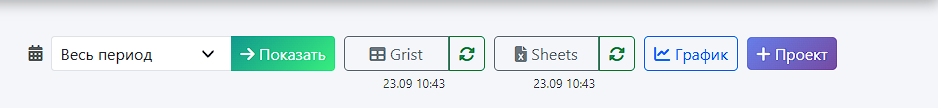
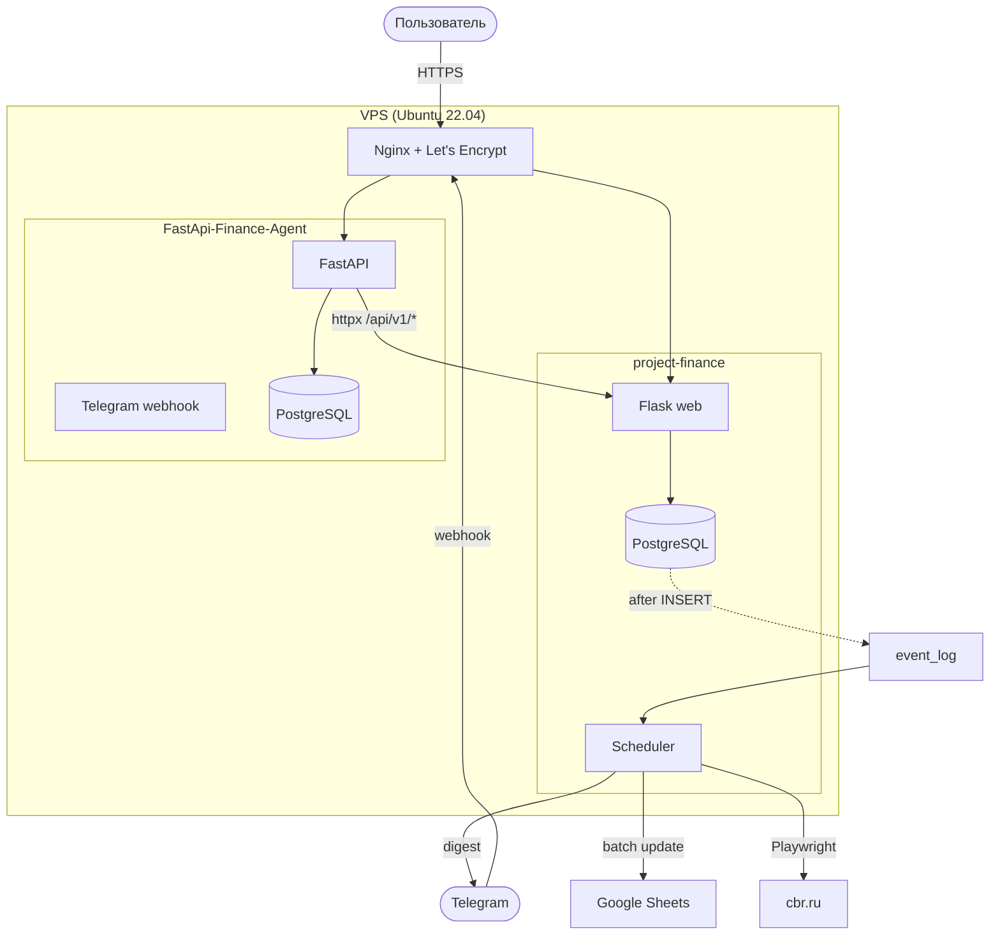

# 💰 Финансы проектов

[](https://github.com/daniil-avdeenko/project-finance/actions/workflows/ci.yml)
[](https://www.python.org/downloads/)
[](https://github.com/astral-sh/ruff)

Flask-приложение для учёта доходов и расходов по проектам: CRUD,
аналитика рентабельности, экспорт в CSV/Excel, синхронизация с Google Sheets,
event-driven уведомления в Telegram, планировщик фоновых задач.

**Live demo:** https://projectfin.com.ru/ — логин `admin` / `admin`

**Связанный проект:** [FastApi-Finance-Agent](https://github.com/daniil-avdeenko/FastApi-Finance-Agent) —
Telegram AI-агент, который ходит в публичный REST API этого приложения
и отвечает на вопросы о финансах на естественном языке.

**Скриншоты:**

| Дашборд | Карточка проекта |
|---|---|
|  |  |

| Транзакции с фильтрами | Telegram-уведомления |
|---|---|
|  |  |

**Ручная синхронизация интеграций из UI:**



## Возможности

- **CRUD** проектов, сотрудников (с ролями на проектах), категорий и транзакций. Роли: админ / пользователь.
- **Дашборд** с доходом, расходом, прибылью и рентабельностью за выбранный период.
- **Мультивалютность.** Транзакции в RUB / USD / EUR конвертируются в рубли по актуальному курсу ЦБ на дату.
- *- **Курсы ЦБ** парсятся с `cbr.ru` через Playwright (обход DDoS-Guard) и сохраняются в БД.
- **Экспорт** в CSV, XLSX (openpyxl) и синхронизация с Google Sheets: проекты, транзакции и последние курсы валют, валидация полей.
- **Event-driven уведомления в Telegram** через очередь событий в БД и отдельный процесс-планировщик.
- **Публичный REST API** `/api/v1/*` — используется внешним Telegram-агентом.
- **Ручная синхронизация** из UI с отображением статуса и времени последней синхронизации.
- **Security:** rate limiting на логин, security headers, sanitize секретов в логах, fail-fast на `SECRET_KEY`.

## Архитектура



**Ключевые принципы:**

- **Разделение процессов.** Web и scheduler — два независимых контейнера в одном деплое. Scheduler запускается отдельно от Flask, чтобы при нескольких воркерах gunicorn задачи не дублировались.
- **Event-driven.** Flask не вызывает Telegram напрямую — пишет событие в `event_log`, scheduler раз в 30 секунд выгребает pending и отправляет digest. Отказ Telegram не блокирует UX, события не теряются.
- **Идемпотентность.** Google Sheets перезаписывается целиком при каждом запуске синхронизации. Повторный запуск обновляет, а не дублирует.
- **Устойчивость к сетевым сбоям.** Sanitize трейсбеков перед отправкой в Telegram, graceful degradation при отказе внешних сервисов.
- **Развязка сервисов.** Агент общается с приложением только через публичный API `/api/v1/*`. Нет shared-credentials к БД, можно менять и деплоить проекты независимо.
- **Гибкая конфигурация секретов.** Google credentials читаются из `GOOGLE_CREDENTIALS_B64` (base64 в env) с fallback на файл — работает и на VPS, и локально.

## Стек

| Слой | Технологии |
|---|---|
| Backend | Python 3.12, Flask, SQLAlchemy, Flask-Login, WTForms |
| БД | PostgreSQL 16 (prod), SQLite (dev) |
| HTTP | httpx (async), requests |
| Browser | Playwright (Chromium) |
| Планировщик | APScheduler (AsyncIOScheduler) |
| Интеграции | Google Sheets API, Telegram Bot API |
| UI | Bootstrap 5, Chart.js, Font Awesome |
| Экспорт | CSV (stdlib), XLSX (openpyxl) |
| Тесты | pytest, pytest-asyncio, pytest-cov, respx |
| Качество | ruff, mypy, pre-commit, gitleaks |
| Инфраструктура | Docker Compose, Nginx, Let's Encrypt, VPS (Ubuntu 22.04) |

## Быстрый старт

### Локально

```bash
git clone https://github.com/daniil-avdeenko/project-finance.git
cd project-finance
python -m venv .venv && source .venv/bin/activate   # Windows: .venv\Scripts\activate
pip install -r requirements-dev.txt
playwright install chromium
cp .env.example .env                                 # заполнить переменные
flask db upgrade && python seed.py
python run.py                                        # http://127.0.0.1:5000
```

**Планировщик — отдельным терминалом:**

```bash
python -m scheduler.runner
```

### Docker (dev)

```bash
docker compose build
docker compose up -d
```

Поднимутся два контейнера: `pf-web` (порт 5000) и `pf-scheduler` (healthcheck на 8080).
Оба используют один образ, но разные команды запуска.

## Развёртывание на VPS

Production — один VPS (Ubuntu 22.04), Nginx как
reverse proxy, Let's Encrypt для HTTPS, Docker Compose для сервисов.

### Структура

- **Nginx** — терминирует SSL, проксирует:
  - `projectfin.com.ru` → `127.0.0.1:5000` (Flask)
  - `agent.projectfin.com.ru` → `127.0.0.1:8000` (FastApi-Finance-Agent)
- **Flask + Scheduler** — контейнеры `web` и `scheduler`, gunicorn 1 worker.
- **PostgreSQL 16** — изолированная docker-сеть, порт наружу не открыт, лимит 512 MB.

### Запуск

```bash
cd /opt/project-finance
docker compose -f docker-compose.prod.yml build
docker compose -f docker-compose.prod.yml up -d postgres
sleep 15
docker compose -f docker-compose.prod.yml run --rm web flask db upgrade
docker compose -f docker-compose.prod.yml run --rm web python seed.py
docker compose -f docker-compose.prod.yml up -d
```

### Переменные окружения

Секреты хранятся в `/opt/project-finance/.env.prod` (не в репозитории).
Шаблон — `.env.example`. Обязательные:

```ini
FLASK_ENV=production
SECRET_KEY=<32 байта hex>
POSTGRES_USER=finance
POSTGRES_PASSWORD=<hex>
POSTGRES_DB=project_finance
DATABASE_URL=postgresql://finance:<pass>@postgres:5432/project_finance

TELEGRAM_BOT_TOKEN=<токен от @BotFather>
TELEGRAM_CHAT_ID=<ID чата>

GOOGLE_CREDENTIALS_B64=<credentials.json в base64>
GOOGLE_SPREADSHEET_ID=<ID таблицы>

EVENTS_ENABLED=true
RATELIMIT_ENABLED=true
HEALTHCHECK_ENABLED=true
HEALTHCHECK_PORT=8080
```

## Публичный API

REST API `/api/v1/*` — используется Telegram-агентом
[FastApi-Finance-Agent](https://github.com/daniil-avdeenko/FastApi-Finance-Agent).
Без авторизации, rate limit 60 req/min на IP.

| Метод | Путь | Назначение |
|---|---|---|
| GET | `/api/v1/health` | Healthcheck |
| GET | `/api/v1/summary` | Сводка за период |
| GET | `/api/v1/projects` | Список проектов |
| GET | `/api/v1/projects/<id>` | Детали проекта + транзакции |
| GET | `/api/v1/transactions` | Транзакции с фильтрами и пагинацией |
| GET | `/api/v1/currencies` | Курсы валют ЦБ |

Swagger UI: `/api/v1/docs` (за `@login_required`).

## Качество кода и CI/CD

- **Pre-commit:** ruff (линтер + форматтер), mypy, gitleaks, conventional-commit —
  запускаются локально на каждом коммите.
- **GitHub Actions** (`.github/workflows/ci.yml`): на каждый push в `main` и PR
  два параллельных job'а — `pytest` (245+ тестов, coverage 88%) и `ruff check` +
  `ruff format --check`. Версия ruff закреплена для совпадения с pre-commit.
- **Branch protection:** PR обязателен, статус-чеки CI должны быть зелёными,
  force-push и удаление `main` запрещены.
- **Conventional Commits** и feature-ветки — читаемая история.

## Управление зависимостями

Зависимости разделены на prod и dev, lock-файлы генерируются через `pip-tools`.

| Файл | Назначение |
|---|---|
| `requirements.in` | Прямые prod-зависимости без версий |
| `requirements-dev.in` | Prod + dev-tooling (pytest, ruff, mypy, pre-commit) |
| `requirements.txt` | Lock-файл prod (в Docker-образ, в prod) |
| `requirements-dev.txt` | Lock-файл dev (локально, в CI) |

**Docker-образ** ставит только `requirements.txt` — без pytest, ruff, mypy и их транзитивных зависимостей. Это сокращает размер образа и поверхность атаки.

**Обновление lock-файлов.** `pip-compile` запускается в Linux-контейнере (`scripts/requirements-compile.Dockerfile`) — это гарантирует, что linux-only пакеты и маркеры платформы резолвятся корректно, независимо от ОС разработчика.

```bash
./scripts/compile-requirements.sh      # Linux / macOS / Git Bash
.\scripts\compile-requirements.ps1     # Windows PowerShell
```

## CLI-команды

```bash
flask sync-sheets         # Синхронизация с Google Sheets
flask scrape-cbr          # Парсинг курсов ЦБ (Playwright)
flask send-test-message   # Тест Telegram-уведомлений
```

## Роли и seed-данные

После `python seed.py` создаются 6 проектов, 30+ сотрудников с ролями на проектах,
и ~470 транзакций в RUB/USD/EUR.

- **Администратор:** `admin` / `admin` — полный доступ, ручная синхронизация, экспорт.
- **Пользователь:** `user` / `user` — просмотр, создание транзакций, экспорт.

> Данные в публичном демо — сгенерированные. Все проекты, компании и
> сотрудники вымышлены.

## Структура

```
app/
├── models.py                  # SQLAlchemy-модели
├── events.py                  # SQLAlchemy listeners для event_log
├── forms.py, helpers.py       # WTForms, утилиты
├── routes/                    # CRUD-роуты по сущностям
├── api/v1/                    # публичный REST API
├── integrations/
│   ├── google_sheets.py       # gspread + валидация + base64 credentials
│   ├── telegram.py            # Bot API, sanitize трейсбеков
│   └── cbr_scraper.py         # Playwright + обход DDoS-Guard
├── services/
│   ├── currency_service.py    # upsert курсов, конвертация
│   ├── project_stats.py       # расчёт показателей без N+1
│   ├── excel_export.py        # xlsx через openpyxl
│   └── sync_service.py        # SyncLog, короткие ошибки для UI
├── templates/, static/
└── security.py                # HTTP headers + sanitize секретов

scheduler/
├── jobs.py                    # process_events, sync_grist, scrape_cbr, sync_sheets
└── runner.py                  # точка входа APScheduler + healthcheck на :8080

migrations/versions/            # Alembic
tests/                          # pytest-тесты
scripts/                        # вспомогательные скрипты
Dockerfile, docker-compose.yml, docker-compose.prod.yml
```

## Что планируется улучшить

- **Batch API для Google Sheets.** Сейчас синхронизация делает ~8 отдельных
  HTTP-запросов (clear + update + formatting на каждый лист). `batchUpdate`
  сожмёт их до 1–2 запросов, экономия ещё 3–5 секунд на синхронизацию.
- **Uptime-мониторинг.** Uptime Kuma в отдельном контейнере: пинг `/healthz`
  каждую минуту, алерты в Telegram.
- **Бэкапы PostgreSQL.** Ежедневный `pg_dump` с ротацией (30 дней) и
  выгрузкой в S3-совместимое хранилище.
- **CI/CD на VPS.** GitHub Actions → SSH → `docker compose pull && up -d`.
- **Гибкая система ролей и audit log.** Сейчас `admin` / `user` покрывают
  сценарии двух пользователей. С ростом команды понадобятся роли с
  разными правами и история действий.
- **Интерактивный Telegram-бот.** Сейчас бот только отправляет уведомления.
  Полезно добавить команды:
  - `/status` — время последней синхронизации, количество проектов и транзакций, курсы валют
  - `/sync` — ручной запуск синхронизации с Grist и Sheets из чата
  - `/report` — сводка за месяц по проектам

## Лицензия

MIT
